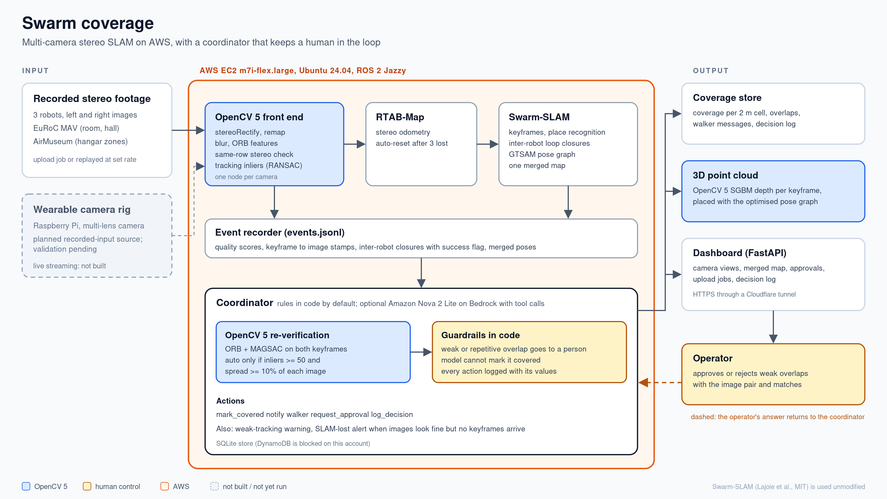
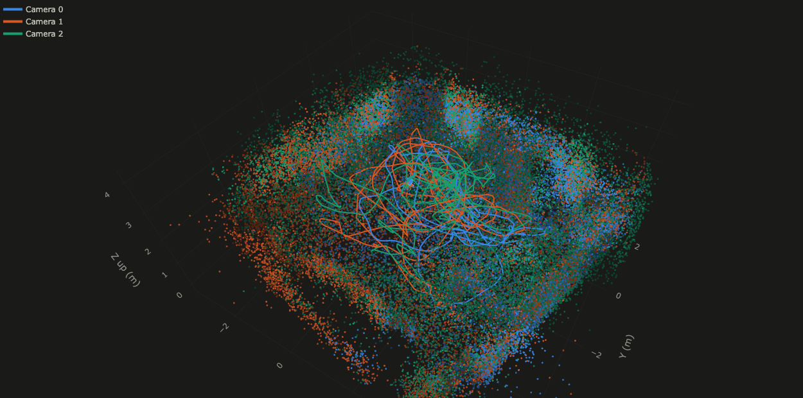
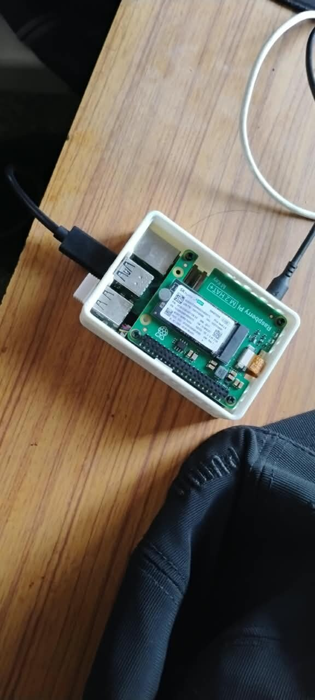
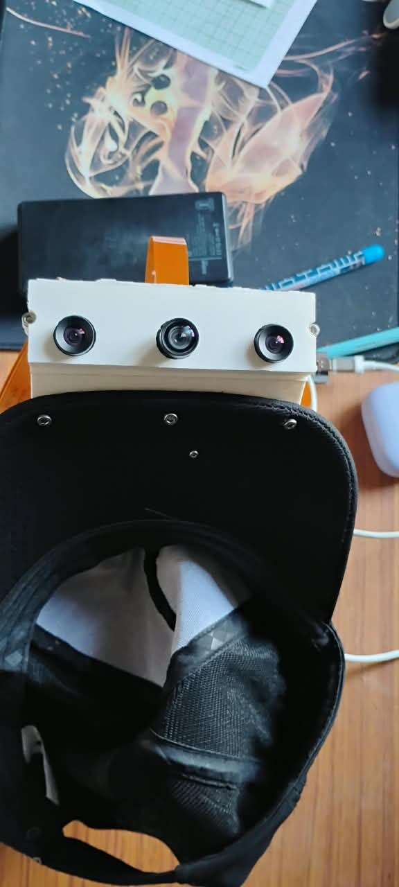

# Swarm coverage

Several people map a space with stereo cameras. **Swarm coverage** merges their maps into one, tells each camera operator when an area is already covered or their tracking is weak, and asks a human before it trusts weak visual evidence.

OpenCV 5 does the image work. Swarm-SLAM builds the shared map. A coordinator turns the evidence into decisions, and every decision is logged with the values behind it. It runs on AWS EC2.

Built for the OpenCV 5 hackathon, Agentic Vision track.



> **Status.** Every result below comes from recorded footage processed on one EC2 server. Live camera streaming is not built. Near-real-time mapping is a goal and is not demonstrated: on this 2-vCPU server the stored map trailed a 1x feed by about a minute. Results from our own on-site recordings are not in yet; the capture hardware is described at the end.

## Features

- **OpenCV 5 front end per camera.** Stereo rectification (`stereoRectify`, `remap`), blur, ORB features, a same-row stereo check and tracking inliers (RANSAC fundamental matrix). No `cv_bridge`; images are converted directly.
- **Multi-robot SLAM.** RTAB-Map stereo odometry with automatic reset after tracking loss, and Swarm-SLAM for keyframes, inter-robot loop closures and one merged pose graph.
- **Coverage decisions with a human gate.** Each proposed overlap is re-checked with OpenCV 5 (ORB and MAGSAC). Strong, well-spread evidence marks the area covered and tells the other camera to move on. Weak or repetitive evidence waits for a person. The guardrail is in code, so neither rules nor a model can bypass it.
- **Operator warnings.** Weak tracking, and "SLAM lost while the images look fine" when good frames arrive but no keyframes do.
- **Event recorder.** One `events.jsonl` per run, so decisions can be replayed and audited without ROS.
- **Rules-only or model coordinator.** The same rules run in code (`--rules-only`); Amazon Nova 2 Lite on Bedrock with tool calls is optional.
- **Dashboard.** Camera views, merged map and coverage cells, approval cards with both keyframes and the matches, decision log, saved-run viewing, and a 3D point cloud.
- **Upload jobs.** Upload, per robot, a left video, a right video and a stereo calibration (the project's YAML or a Kalibr camchain) in the browser. The server converts them (frame sync, rectification, left/right-swap check) and runs the pipeline.
- **3D point cloud.** OpenCV 5 SGBM depth per keyframe, placed with the optimised pose graph, 4 cm voxels.

## Testing and validation

We tested on recorded footage, with ground truth where it exists.

| Footage | What it tested | Ground truth |
|---|---|---|
| **EuRoC MAV**, Vicon Room 1 and Machine Hall, 3 flights each, 0.25x feed | merging, coverage claims, failure injection, thresholds | yes |
| **AirMuseum** scenario 3, a hangar with zones, 3 robots at 10 Hz | upload jobs, cloud building, throughput on the Free-plan server | conversion not verified |

### EuRoC results (measured against ground truth)

| | Result |
|---|---|
| Merged map, 3 robots, one alignment | Vicon Room: **0.895 m unmerged to 0.207 m merged**. Machine Hall: **7.9 to 9.0 cm** |
| Rectification on real pairs | same-row matches **0% raw, 90% rectified** |
| "Area covered" precision / recall | **1.00** in every run / 0.667 (room), 0.22 to 0.375 (hall) |
| Weak-tracking warning after blank wall / quick shake | +0.3 s / +0.2 s |
| SLAM recovery after a blank wall | 147 s to 1.6 s with odometry auto-reset (accuracy cost: 0.34 m joint) |
| Look-alike false closures (6 injected) | 4 held for a human, 2 auto-covered |
| Frame to "area covered" | about 30 s median at a 0.25x feed |

These numbers are from the earlier phase, which used the Nova coordinator. Details and the failures we hit and fixed are in [`docs/REPORT.md`](docs/REPORT.md) and [`docs/FINDINGS.md`](docs/FINDINGS.md).




### AirMuseum results (no accuracy claim)

- Full run at 0.25x: 595,574-point cloud, 5 overlaps applied, 235 Swarm-SLAM closures rejected.
- Fed at 1x on this server, the stored map trailed the feed by about 66 s when the feed ended. Full tracking at 1x kept only 58 to 61% of frames. **1x is not demonstrated.**
- No trajectory error is reported for this footage. Its reference trajectory was not verified, so any error figure would not be a valid measurement.

### What replays and compute mean here

The dashboard can show a saved run. A *replay* re-runs the coordinator over recorded events at a chosen speed; it does not re-run SLAM, and the approvals it raises are generated by the replay.

## Repository

| Path | What |
|---|---|
| `frontend/` | OpenCV 5 front end, EuRoC replay, calibration import |
| `launch/`, `config/` | 3-robot launch, Swarm-SLAM configs |
| `coordinator/` | recorder, coordinator, optional model agent, OpenCV 5 re-verification, SQLite store |
| `dashboard/` | FastAPI app, pages, upload job API |
| `jobs/` | upload-driven job runner |
| `eval/` | trajectory error, coverage precision and recall, latency, failure timeline |
| `scripts/` | EC2 setup, OpenCV 5 environment, footage download, run scripts, demo server |
| `tests/` | 48 tests |
| `docs/` | report, findings, deployment runbook, video script, figures |
| `swarm.repos` | Swarm-SLAM packages pinned to tested commits |

## Build and run

Tested on one EC2 m7i-flex.large (2 vCPU, 8 GB), Ubuntu 24.04 x86_64, 4 GB swap, 48 GB root disk. Keep several GB of disk free; runs and derived frames fill it. The step-by-step deployment is in [`docs/DEPLOYMENT.md`](docs/DEPLOYMENT.md).

```bash
# 1. ROS 2 Jazzy, RTAB-Map, GTSAM 4.2, Swarm-SLAM at pinned commits (about 15 min)
scp scripts/ec2_setup.sh swarm.repos ubuntu@<ec2>:~/
ssh ubuntu@<ec2> 'bash ~/ec2_setup.sh ~/swarm.repos'

# 2. OpenCV 5 environment next to ROS
ssh ubuntu@<ec2> 'cd ~/OpenCVH && bash scripts/setup_cv5env.sh'

# 3. EuRoC footage
ssh ubuntu@<ec2> 'python3 ~/OpenCVH/scripts/fetch_euroc.py vicon_room1 V1_01_easy V1_02_medium V1_03_difficult'

# 4. Run 3 robots at quarter speed, publishing every 2nd frame
ssh ubuntu@<ec2> 'cd ~/OpenCVH && SEQS=V1_01_easy,V1_02_medium,V1_03_difficult bash scripts/run_euroc.sh myrun 0.25 2 900'

# 5. Evaluate against ground truth (EuRoC)
python -m eval.cslam_eval runs/myrun gt
python -m eval.coverage_pr runs/myrun gt

# 6. Coordinator: rules only, or Nova on Bedrock (needs an IAM role)
python -m coordinator.main runs/myrun --rules-only [--speed 2]

# 7. Dashboard behind a Cloudflare quick tunnel (prints the URL and the approval token)
bash scripts/serve_demo.sh ~/runs/myrun 2

# Tests (need several GB of free disk)
python -m pytest -q tests
```

**Pinned versions** (checked 22 to 24 Oct 2026): OpenCV 5.0.0 (`opencv-contrib-python-headless==5.0.0.93`), ROS 2 Jazzy, RTAB-Map 0.23.13, GTSAM 4.2.0, PyTorch 2.14.1+cpu, numpy 1.26.4 on EC2, Swarm-SLAM commits in `swarm.repos`, Bedrock `us.amazon.nova-2-lite-v1:0`, cloudflared 2026.10.0.

**Test status.** 48 tests; on the last run 42 passed and 6 failed. Five of the failures, in `tests/test_jobs_runner.py`, raise the runner's free-disk check on a server with 1.2 GB free. The sixth was not identified.

## Limitations

- Recorded footage only. Live streaming from the rig is not built.
- Not real time. 1x is not demonstrated on this server; the AWS Free plan refused a larger instance.
- AirMuseum accuracy is not established.
- Free-plan limits: DynamoDB, load balancer and Lambda are blocked and Anthropic models are refused on Bedrock, so the project uses SQLite, a tunnel and Nova. The COOL / Graviton benchmark was not run.
- 2 of 6 planted look-alike closures still auto-cover.
- Coverage recall is low in the hall (0.22 to 0.375), because claims come only from inter-robot closures.
- The Cloudflare quick-tunnel URL changes on every restart.

## Hardware setup

Capture hardware for on-site recordings: a Raspberry Pi with an M.2 HAT+ in a printed case, and a printed enclosure with three camera lenses mounted on a cap for hands-free carrying. The rig is the planned recorded-input source. Whether its output matches the upload format (two videos per robot plus a calibration) has not been checked, and no recordings or results from it are included yet. Validation is pending.

<p>


</p>

## Credit and license

Builds on **Swarm-SLAM** (Lajoie and Beltrame, IEEE RA-L 2024, MIT, https://github.com/MISTLab/Swarm-SLAM), **RTAB-Map**, **GTSAM**, **CosPlace** (Berton et al., CVPR 2022), the **EuRoC MAV dataset** (Burri et al., IJRR 2016) and the AirMuseum footage. Swarm-SLAM is used unmodified. This team built the OpenCV 5 front end, the ROS bridge, the recorder, the coordinator and guardrails, the dashboard and job runner, the failure injection and the evaluation.

License: not yet specified.
