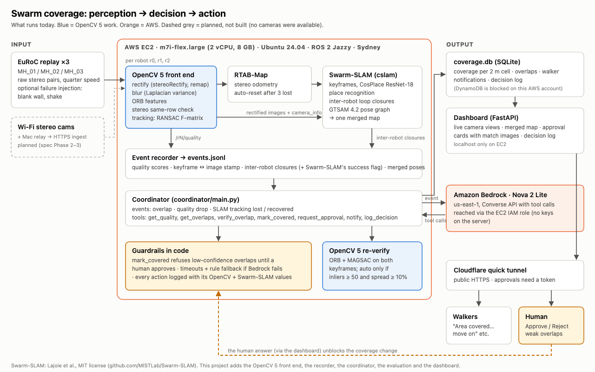
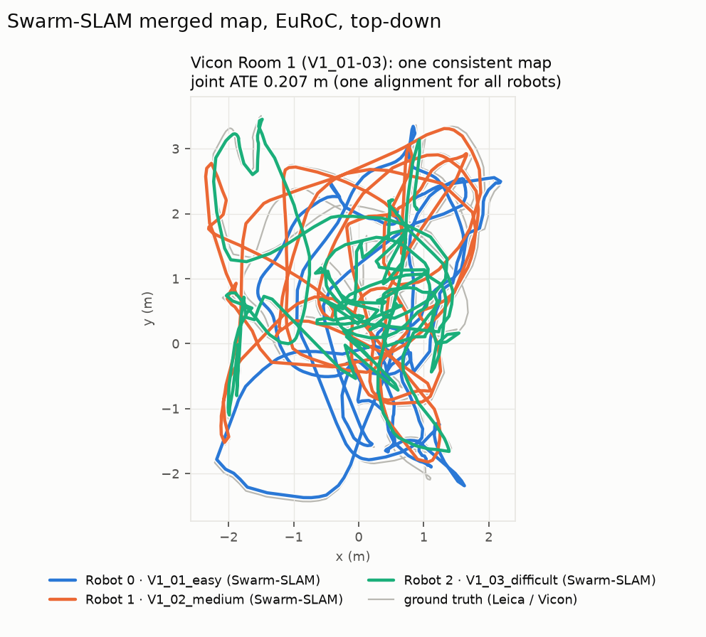
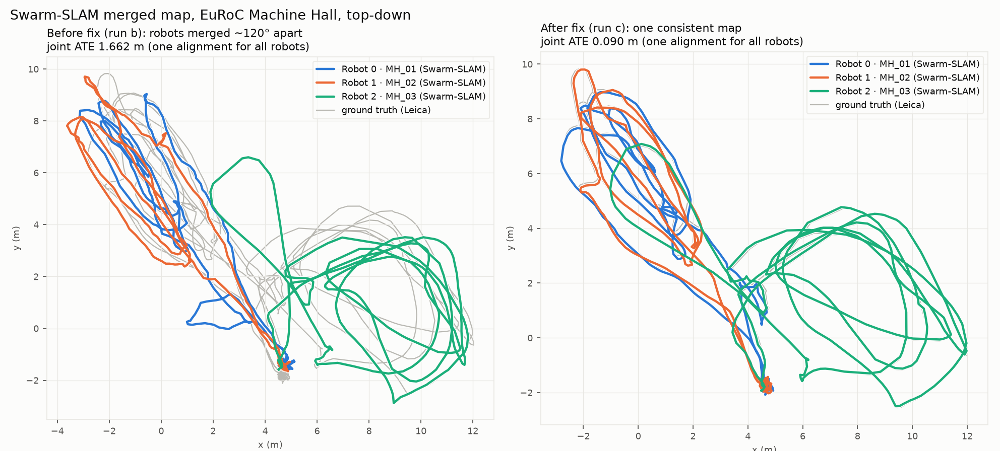

# Swarm coverage: multi-camera visual SLAM with an agentic coordinator

Technical report v3 (working draft) · OpenCV 5 hackathon, Agentic Vision Award track · prepared 2026-10-26 (IST)

> **Draft status.** Not submitted or published. Sections 1-10 are the 2026-10-25 report, re-checked for scope. Section 11 is new (AirMuseum upload jobs, lighter 3-robot runs, replay vs compute). Section 12 (the team's final stereo footage test) is **PENDING**: no result exists and none is claimed. [TEAM] marks facts only the team can supply.
>
> **Phase tags used throughout.** **[EuRoC, Nova]** = EuRoC runs where the coordinator used Amazon Nova on Bedrock. **[EuRoC, rules replay]** = a saved EuRoC run re-played through the same rules in code, no Nova. **[AirMuseum, compute]** = uploaded AirMuseum images processed by the pipeline on EC2 in that run, decisions by rules in code. A *replay* re-shows recorded events; it is not new computation.

Numbers below were measured in the runs named; each section says which phase. Measured error against ground truth is shown only where ground truth was checked (EuRoC). Run directories,
scripts and the full chronological record are in the repository (`docs/FINDINGS.md`).

## 1. Problem

When several people map a building with cameras, they waste time filming the same rooms
twice, they don't know when their footage has become useless (blur, a blank wall, fast
turns), and a map built from bad matches silently goes wrong. We want three walkers to map
a space together while a system:

1. merges their three maps into one,
2. tells each walker, as a design goal near real time (not demonstrated, see Section 8), when an area is already covered or their tracking is weak,
3. asks a human before trusting weak visual evidence, and
4. keeps a trace that shows *why* each instruction was given.

## 2. Users

- **Mapping crews** (building surveys, facility inventories, real-estate capture). They want
  coverage with fewer passes, and an instruction when footage is unusable.
- **A supervisor** who answers approval requests and needs to see the evidence behind them.
- **Reviewers** (here: judges) who need to audit why the system acted.

## 3. Architecture

Perception → decision → action:

| Stage | Component | Output |
|---|---|---|
| Perception | OpenCV 5 front end per camera (`frontend/`) | rectified images; per-frame blur, ORB features, stereo same-row share, tracking inliers |
| Perception | RTAB-Map stereo odometry → Swarm-SLAM (3 robots, one ROS 2 domain) | keyframes, inter-robot loop closures, merged pose graph |
| Recording | `coordinator/recorder.py` | one `events.jsonl` per run (the agent never imports ROS) |
| Decision | `coordinator/main.py`. [EuRoC, Nova]: Amazon Nova 2 Lite with tool calls. Later runs: the same rules in code (`--rules-only`), no Nova | OpenCV 5 re-verification, coverage decisions, approval requests |
| Action | tools `notify`, `mark_covered`, `request_approval`, `log_decision` | walker messages, coverage records, decision log |
| Human control | dashboard approval cards (image pair + matches) | the human's answer unblocks or drops the coverage change |

The coordinator can follow `events.jsonl` as it grows or replay a recorded run (the spec's fallback). Every input so far was recorded footage processed on EC2 or replayed; no live camera was used.

## 4. OpenCV 5 implementation

All image work in our code runs on **OpenCV 5.0.0** (`opencv-contrib-python-headless==5.0.0.93`).
The node refuses to start on another version (it asserts `cv2.__version__`), because Ubuntu's
OpenCV 4.6 sits on the same machine for ROS.

| Function | OpenCV 5 calls | Used for |
|---|---|---|
| Rectification | `stereoRectify` (`CALIB_ZERO_DISPARITY`), `initUndistortRectifyMap`, `remap`; `fisheye.*` variants | Swarm-SLAM input (it hard-codes `alreadyRectified = true`) |
| Blur | `Laplacian(...).var()` | shown on the dashboard; not a trigger (scene-dependent, Section 6.4) |
| Features | `ORB_create(1000)`, `BFMatcher(NORM_HAMMING)` | quality score, stereo check |
| Stereo check | same-row + positive-disparity share of left↔right matches | rectification evidence, quality |
| Tracking check | `findFundamentalMat(FM_RANSAC)` vs previous frame | weak-tracking warnings (< 0.5), with feature count (< 100) |
| Overlap re-verification | ORB(1500) + ratio test, `findFundamentalMat(USAC_MAGSAC)`, `convexHull`/`contourArea` | deciding auto-cover vs human approval |
| Evidence images | `drawMatches` | approval cards |
| Calibration import | EuRoC `sensor.yaml` → K, D, R, T (`frontend/euroc_to_calib.py`) | rectification maps |

**Integration detail.** `rclpy` and `cv_bridge` are built against numpy 1.26 and OpenCV 4.6.
The OpenCV 5 wheel declares numpy ≥ 2, but wheels built against numpy 2 also run on numpy 1.x.
So OpenCV 5 is installed with `--no-deps` into a venv that sees the system packages, and our
nodes convert `sensor_msgs/Image` to and from NumPy themselves instead of using `cv_bridge`.

**Evidence on real frames** (`scripts/check_rectification.py`, 60 EuRoC MH_01 pairs): the share of
left↔right ORB matches on the same row with positive disparity is **0.000 raw and 0.900 rectified**.
Raw, the right image sits about 13 px higher. After rectification, the median vertical offset of
the RANSAC inliers is 0 px. Unit tests check that synthetic rectified epipolar lines are horizontal
(< 0.5 px) and that a blurred frame scores lower.

## 5. AWS deployment

| Part | Service | Notes |
|---|---|---|
| SLAM, front end, coordinator, dashboard | EC2 m7i-flex.large, Ubuntu 24.04, Sydney | 2 vCPU, 8 GB, 4 GB swap, 48 GB root disk (98% used at last check); ROS 2 Jazzy + `ros-jazzy-gtsam` 4.2.0 |
| Agent | Amazon Bedrock, Nova 2 Lite (us-east-1), Converse API with tool calls. **EuRoC phase only** | reached through an EC2 IAM role, so there are no keys on the server. Not used in the AirMuseum or replay runs described in Sec. 11 |
| Public endpoint | Cloudflare quick tunnel → FastAPI on localhost | HTTPS with a valid certificate, no inbound port; answering approvals needs a token |

**What the account allowed.** The account is on the AWS Free plan. The organization's service
control policy blocks DynamoDB, ELB, Lambda and SNS for the IAM user, and Bedrock refuses Anthropic
models. We adapted: SQLite instead of DynamoDB, a tunnel instead of an ALB, and Amazon Nova instead
of Claude. EC2 instances are launched by the account owner in the console and operated over SSH.
The optional COOL / Graviton benchmark was not run.

**Cost.** About $0.12/h for the instance (estimate from the earlier phase; credit balance and expiry were not checked). One full Bedrock replay of a run is
about 127 Nova calls (226k input / 7.2k output tokens).

## 6. Evaluation

**Data.** EuRoC MAV flights act as cameras 0 / 1 / 2, in two environments: **Vicon Room 1**
(V1_01_easy / V1_02_medium / V1_03_difficult, an indoor room with mats and clutter, Vicon ground truth;
used for the demo) and the **Machine Hall** (MH_01_easy / MH_02_easy / MH_03_medium, an industrial hall,
Leica laser-tracker ground truth). These are real stereo footage (752×480, 20 Hz) from one rig, with
ground truth in a shared frame per environment. They come from the Hugging Face mirror `GlowBond/EuRoC_MAV_Dataset`, because ETH's
server blocks scripted downloads. [EuRoC phase] The feed ran at 0.25× real time and published every 2nd frame, so each camera sent 2.5 pairs/s; that is the rate 3 robots on 2 vCPU sustained then. The AirMuseum runs (Sec. 11) used different rates.

### 6.1 Merged map vs single camera (ATE RMSE vs ground truth)

"Joint" places all three robots with **one** SE(3) alignment, so it is only low if the maps are
merged consistently.

| Run | Inter-robot closures | Cam 0 | Cam 1 | Cam 2 | Joint |
|---|---|---|---|---|---|
| c: odometry only | — | 0.103 m | 0.086 m | 0.237 m | 0.274 m* |
| c: Swarm-SLAM merged | 28 | 0.088 m | 0.071 m | **0.071 m** | **0.090 m** |
| d: Swarm-SLAM merged | 24 | 0.062 m | 0.055 m | 0.101 m | **0.079 m** |
| **Vicon Room 1**: odometry only | — | 0.286 m | 0.317 m | 0.458 m | 0.895 m |
| **Vicon Room 1**: Swarm-SLAM merged | 12 | 0.243 m | **0.059 m** | **0.159 m** | **0.207 m** |

\*All MH flights take off from the same pad, so the unmerged odometry frames line up by
coincidence. Per-robot ATE is the fair single-camera baseline there. The Vicon Room flights don't share
a start pose, so their 0.895 → 0.207 m is a direct measure of what merging adds. The room error is
higher than the hall's because these flights are faster and more aggressive.

**Bug found on the way (run b).** The per-robot ATE improved, but whole robots were merged rotated
by ~120°. That is exactly the camera_link→camera_optical rotation we had published. All 13
closures that could be checked against ground truth were true matches (0.01–1.6 m apart), so the
frames were wrong, not the matches. Stamping images in the base frame, as Swarm-SLAM's own KITTI
launch does, fixed it: joint ATE went from 1.662 m to 0.090 m.

### 6.2 Coverage precision and recall

A claim ("area covered by A, B move on") is correct if the two keyframes were within 3 m of each
other in ground truth. Recall is measured over 2 m ground-truth floor cells visited by ≥ 2 cameras.

| Run | Precision | Recall |
|---|---|---|
| d | **1.00** (10/10 claims with ground truth) | 0.22 (4/18) |
| d + 6 injected false closures | 0.83 (2 wrong) | 0.22 |
| f (failures + auto-reset) | **1.00** (23/23) | 0.375 (6/16) |
| Vicon Room 1 | **1.00** (7/7) | **0.667** (6/9) |

Recall is low in the hall by design (much higher in the small room, where views overlap constantly).
Coverage is only claimed at inter-robot closures, and Swarm-SLAM reports at most one per 5 s (`inter_robot_loop_closure_budget: 1`). The dashboard shows cells where two
merged paths cross as "not verified", but doesn't claim them.

### 6.3 Latency (frame → walker notification) [EuRoC, 0.25x feed; Bedrock rows are Nova]

These are wall-clock figures at a quarter-speed feed. They do not describe live use and say nothing about the AirMuseum runs.

| Stage | Median | p90 |
|---|---|---|
| OpenCV 5 front end, per frame | 0.19 s | 0.33 s |
| Swarm-SLAM: frame → inter-robot closure | 27 s wall (~7 s data) | 227 s |
| Bedrock decision: overlap (hall / room) | 2.18 s / 2.19 s | 2.40 s / 2.49 s |
| Bedrock decision: quality drop (hall / room) | 0.97 s / 1.03 s | 1.28 s / 1.36 s |
| Dashboard refresh | ≤ 1 s | |

Frame → "area covered" on the dashboard is about **30 s**, almost all of it loop-closure detection
(it runs every 5 s, and 2 vCPU are shared by three robots). Quality warnings take about 1–3 s.

### 6.4 Failure cases

The spec's cases were created from EuRoC and tagged frame by frame (`--perturb`). Front-end scores
(`scripts/check_perturb.py`): clean blur 275 / 1000 features / tracking 0.94; **blank wall**
blur 20 / 0 features; **quick shake** blur 10 / tracking 0.20.

| | Run e (RTAB-Map default) | Run f (`Odom/ResetCountdown=3`) |
|---|---|---|
| "Slow down" after a blank wall / shake | **+0.3 s / +0.2 s** (data time) | +0.3 s / +0.2 s |
| SLAM back after the blank wall ended | 147 s (never during the walk) | **1.6 s** |
| Lost frames, blank / shake | 202 / 179 | 63 / 15 |
| Keyframes, cams 1 / 2 (clean ≈ 440 / 405) | 324 / 337 | 442 / 403 |
| Joint ATE | 0.069 m (post-failure map missing) | 0.336 m |

- **What went wrong first.** Without auto-reset, odometry never recovered, and the coordinator kept
  saying "Tracking OK" because the *images* were fine again. Two fixes: auto-reset in RTAB-Map, and a
  coordinator alert when 30 good frames pass with no Swarm-SLAM keyframe ("Camera N, tracking lost:
  walk back to your last mapped area"). Clean runs never exceed 21 such frames, and there were 0 false
  alarms on the healthy cameras of runs d, e and f. An all-clear follows when keyframes resume.
- **Trade-off.** Reset resumes from the last pose, so the motion during the outage is lost: odometry
  error was 2.0 / 6.5 m, and Swarm-SLAM's closures cut that to about 0.41 m per camera. The result is a
  complete map with lower accuracy, instead of an accurate map that silently stops.
- **Two similar-looking places.** We searched 1,500 cross-camera keyframe pairs more than 5 m apart in
  ground truth: median 12 OpenCV inliers, 7 pairs ≥ 50. The worst were **the same object seen from 5–6 m
  away**, with all matches crowded into one patch, rather than look-alike rooms. A spread rule (inliers
  must span ≥ 10% of each image) keeps 19/20 true overlaps with ≥ 50 inliers. We then injected the 6
  hardest pairs as closures that Swarm-SLAM wrongly accepted: **4 were held for a human, 2 auto-covered**.
- **A threshold that didn't transfer (Vicon Room).** The blur limit of 90, tuned in the bright hall,
  marked 31% / 71% / 83% of *normal* room frames as blurry (median blur 128 / 59 / 48), so walkers got 52
  "slow down" messages while tracking was healthy (median tracking inliers 0.65–0.69, 2 lost odometry
  frames in total). Comparing rules on all runs (`eval/quality_rules.py`): tracking < 0.5 or < 100
  features gave 14 warnings in the room (from 52) and 7 in the hall (from 15), and still caught both
  injected failures at the same times. Blur relative to the camera's own median gave 19 / 10. We adopted
  the tracking rule; blur stays on the dashboard as information.

## 7. Agentic Vision evidence [EuRoC, Nova]

Everything in this section is from the Nova-driven EuRoC phase. Counts are as recorded in `docs/FINDINGS.md`; the final replay database named below was not found on the server when re-checked on 2026-10-26, so they are reported, not re-derived. The later AirMuseum and replay runs used rules in code and are not evidence of an agent model.

**Workflow.** OpenCV 5 + Swarm-SLAM perceive; the coordinator (Nova with tools, guardrails in code)
decides; walker notifications, coverage records and approval requests are the actions (Section 3).

**Trace: OpenCV output changing a later decision** (final replays, from `coverage_bedrock_final.db`; rows 1–3 Machine Hall run d, rows 4–5 Vicon Room 1):

| Event | OpenCV 5 values | Decision (Bedrock) | Action |
|---|---|---|---|
| Overlap #1, camera 1 kf 4 ↔ camera 0 kf 1 | 225 inliers, spread 0.221 → high | "high confidence (inliers 225 ≥ 50, spread 0.221 ≥ 0.1)" | `mark_covered`; camera 0: "Area covered by camera 1, camera 0 move on." (2.6 s) |
| Overlap #5, camera 0 kf 11 ↔ camera 2 kf 0 | 26 inliers, spread 0.114 → low | "low confidence: inliers 26 < 50" | `request_approval`; coverage on hold |
| Quality, camera 0 | tracking inliers 0.46 < 0.50 (blur 100.4, 1000 features) | "track_inliers 0.46 (weak below 0.5)" | camera 0: "Camera 0, slow down, tracking is weak." |
| **Vicon Room:** overlap #1, camera 0 kf 5 ↔ camera 2 kf 0 | 138 inliers, spread 0.133 → high | "inliers 138 ≥ 50, spread 0.133 ≥ 0.1" | camera 2: "Area covered by camera 0, camera 2 move on." |
| **Vicon Room:** overlap #4, camera 1 kf 25 ↔ camera 2 kf 15 | 248 inliers but spread 0.085: matches packed on a checkerboard | "low confidence: spread 0.085 < 0.1" | `request_approval`. A repetitive pattern can fool a matcher, so a person checks. |

The same Swarm-SLAM event leads to opposite actions depending on the OpenCV 5 numbers. On the public
dashboard the operator answered 5 such approval requests live, each between 8 and 98 s after it
appeared. Each approval was logged with `source=human`, followed by `mark_covered` and the
notification to the walker.

**Task success** (final Bedrock replays, final rules):

| | Vicon Room 1 | Machine Hall (run d) |
|---|---|---|
| Overlaps auto-covered / held for a human | 11 / 1 | 19 / 5 |
| Closures Swarm-SLAM rejected (logged, not acted on) | 167 | 153 |
| "Slow down" warnings | 15 | 7 |
| Wrong recipients / Bedrock fallbacks | 0 / 0 | 0 / 0 |
| Nova calls (input / output tokens) | 85 (149k / 4.7k) | 106 (191k / 5.9k) |

**Failure handling.** Agent errors we found and fixed, each measured before and after:

1. **Wrong recipient.** In 2 of 24 overlaps, where camera 2 arrived before camera 1, the model messaged
   camera 2. Fix: `verify_overlap` returns `arrived_second` and the exact notification. After: 0/24.
2. **Invented thresholds** in reasons ("inlier ratio 0.49 < 0.5"); no such rule exists. Fix: the tool
   returns `confidence_rule`. After: no invented thresholds.
3. **A hung Bedrock call** froze a replay for 17 min. Fix: 10 s / 30 s timeouts, 3 retries, and a
   per-event fallback to the same rules in code, logged as `source=rules`.
4. **SLAM lost while images look fine** (Section 6.4). Fix: the keyframe-gap alert.
5. **A perception threshold that didn't transfer** to a darker room (52 nuisance warnings). Fix: warn
   on tracking quality, not blur (Section 6.4). After: 14 (room), 7 (hall).

**Observability.** Every action row records time, camera, trigger, the OpenCV and Swarm-SLAM values,
the decision, the action, the model's reason, who decided (`bedrock` / `rules` / `human`) and the
decision latency. MAGSAC is seeded so the same image pair always gives the same numbers. The
dashboard shows the log, the live camera views with their scores, and the evidence images.

**Human control.** `mark_covered` refuses a low-confidence overlap in code, so neither the model nor the
rules can change coverage without approval (`tests/test_coordinator.py`). Approval cards show both
keyframes with the inlier matches. A banner, the tab title and opt-in desktop alerts make requests
hard to miss. Answers need an operator token, because the page is public.

## 8. Limitations

- **Not real time, not live.** All results come from recorded footage. On AirMuseum footage fed at 1x (10 Hz) with every 2nd pair published (about 5 pairs/s) on this 2-vCPU server, the stored map trailed the feed by about 66 s at the moment the feed ended (Sec. 11). Full tracking at a 1x feed saved only 58-61% of frames. 1x is **not demonstrated**.
- **No live cameras or house walks.** Spec Phases 2-3 on hardware (Wi-Fi capture, Mac relay, checkerboard calibration, HTTPS ingest) are not built. Data: EuRoC (a drone flying in a room and a hall, grayscale) and the AirMuseum scenario 3 footage (a hangar with zones, not walled rooms). The failure cases are synthetic edits of real EuRoC frames.
- **Accuracy is established only on EuRoC, not on AirMuseum.** The AirMuseum ground-truth conversion is not verified, so the 3-4 m joint trajectory error (the evaluation script's ATE against that unverified converted reference) is not a valid accuracy measurement, and it does not show the robots agree with each other. It is left out of the README until the reference is verified. Trajectory error (ATE) is not point-cloud accuracy. Offline attempts to improve the cloud (filtering, ICP-style refinement) gave no convincing improvement.
- **Compute.** The server is the largest Free-plan-eligible instance (m7i-flex.large, 2 vCPU). A resize was refused by the plan. Whether a bigger server removes the lag was not tested.
- **Recall** (0.22-0.375 in the hall, 0.667 in the room) is limited by event-driven claims; map-based coverage would raise it.
- **Thresholds** were tuned on the two EuRoC environments; the blur lesson shows they need checking in a real house.
- **Residual risk.** 2 of 6 planted look-alike closures auto-cover. Thresholds were tuned on the same few runs they were evaluated on.
- **Ground truth.** The first seconds of each EuRoC flight have none, so some claims can't be scored (10 of 19 scored in run d).
- **Ephemeral access.** The quick-tunnel URL changes on every tunnel restart, and the server's public IP changed after an unplanned instance restart. The approval token is one shared secret.
- **Code state.** The latest dashboard code is on the server only (uncommitted). Experimental work used for the lighter runs lives in an unreviewed copy outside the repository (Sec. 11).

## 9. Responsible use

- **Privacy.** Cameras walking through homes or workplaces record people and private spaces. Deploy only
  with the occupants' consent, and avoid recording bystanders. Frames stay on the team's own machines
  (the EC2 instance and the evaluation laptop). In the Nova phase Bedrock only received numbers; later runs did not call it. The one third party that
  carries frames is the Cloudflare tunnel, which relays the dashboard to its viewers. Delete runs after
  mapping, and blur faces before sharing any frame.
- **Not for safety-critical decisions.** Coverage and "move on" messages are guidance for mapping crews.
  They must not direct people in emergencies or hazardous sites without a human in charge.
- **Human authority.** Weak evidence always goes to a person, the model cannot bypass that, and every
  decision is attributable. The model only sees summary numbers and IDs, never the images.
- **Unverified accuracy.** Results on footage without verified ground truth are not accuracy claims and must not be used to direct people.
- **Data provenance.** EuRoC is used for research evaluation with credit, obtained from a third-party
  mirror because the official host blocks scripted access.

## 10. Credit

Swarm-SLAM (P.-Y. Lajoie, G. Beltrame, IEEE RA-L 2024, MIT license) is used unmodified, together with
RTAB-Map, GTSAM, CosPlace (Berton et al., CVPR 2022) the EuRoC MAV dataset (Burri et al., IJRR 2016) and the AirMuseum multi-robot stereo footage [TEAM: add the dataset's citation and confirm its terms allow public demo use].
This team built the OpenCV 5 front end and its ROS bridge, the event recorder, the Bedrock coordinator and
its guardrails, the dashboard, the failure injection and all evaluation.

## 11. Phase 2: AirMuseum upload jobs and lighter 3-robot runs (2026-10-26)

**What was added.** An upload-driven job runner and dashboard (three robots' left/right image sets uploaded, pipeline run, cloud shown), plus a 3D cloud builder. AirMuseum scenario 3 is a hangar with zones, not separate rooms. Footage is 10 Hz, about 1,192-1,196 stereo pairs per robot, 120 s. No Nova calls were made in any run in this section.

**Which code produced what.** `job_a93136c4776f` and the Room 1 replay used the repository code (`OpenCVH`). The lighter runs (`lt_r10`, `watch_light`, `watch_light2`) and `pv_r10` used launch switches and configs that exist only in the unreviewed copy `OpenCVH_opt` (not a git repository): preview mode, every-2nd-pair publishing in the job path, a source-pair recorder, and `config/job_light.yaml`. Those results are not reproducible from the repository as it stands.

| Run | Input | Feed rate / published pairs | Mode | Decisions | Result |
|---|---|---|---|---|---|
| `job_a93136c4776f` | AirMuseum scn. 3, 3 robots | 0.25x / every pair | compute | rules in code | 595,574-point cloud; 5 overlaps; 5 applied, 0 pending; 235 Swarm-SLAM closures rejected. The stored cloud lagged the feed |
| `pv_r10` | same footage | 1x / every pair | compute, full tracking | rules | front end saved 58-61% of frames; 1x not demonstrated |
| `lt_r10`, `watch_light`, `watch_light2` | same footage | 1x / every 2nd pair (about 5 pairs/s) | compute, preview config, `OpenCVH_opt` | rules | map's latest timestamp about 66-67 s behind the feed at the moment the feed ended; load average 12-16; joint ATE after optimisation 3.09 / 4.17 / 3.50 m (initial about 17 m). `lt_r10` ended on its own after 200 s; the other two hit the 240 s wall-clock cap (exit 124) |
| `v1_run` | EuRoC Vicon Room 1 | 0.25x / every 2nd pair | original compute run [EuRoC] | its database holds 70 Nova, 10 human and 162 rules decisions | the source of the Room 1 results in Sec. 6 |
| `v1_replay` | the recorded events of `v1_run` | coordinator replay at 3x the original recorded pace; SLAM not re-run | **replay, not compute** | 202 decisions, all rules (no Nova) | 15 overlaps shown; the dashboard ends at 10 applied / 5 pending approvals. The pending ones are replay-generated and nobody decided them |

**Reading the AirMuseum numbers.** "Map about 66 s behind" is the delay of the stored cloud, measured at the end of the feed. It is not a measure of how much footage was mapped. The 3-4 m joint ATE was computed against a ground-truth conversion that was not verified. Treat it as unvalidated: it is neither an accuracy result nor evidence of consistency between robots, and no accuracy is claimed. Tracking every 2nd published pair means about half the frames never entered the pipeline in those runs.

**Recorder.** `watch_light` saved every source pair. `watch_light2` lost 6 of 7,164 messages (robot 1 left/right 1194 vs 1196 pairs, robot 2 right 1190 vs 1192).

**AWS plan.** The account is on the Free plan. A resize was refused with `FreeTierRestrictionError`, so these numbers come from the largest eligible server.

**Tests.** The repository has 48 tests. On 2026-10-26, 42 passed and 6 failed in the first run. A re-run of `tests/test_jobs_runner.py` showed 5 failures, each raising the runner's free-disk check ("not enough free disk space to start" or "not enough disk space for this file") while the server had 1.2 GB free. The sixth failure was not identified. The cause is probably the full disk but this was not confirmed by re-running with free space.

## 12. Final stereo footage test: PENDING

The team's own footage (one stereo rig, two sequential recordings replayed as if simultaneous). **No result exists yet.** Fill with measured values only.

| Item | Value |
|---|---|
| Footage (rig, place, length, rate, consent of anyone filmed) | PENDING |
| Settings (publish rate, tracking, rules or Nova) | PENDING |
| Inter-recording closures found / applied / held | PENDING |
| Stored-map lag at feed end | PENDING |
| Did the two recordings merge (was there a recognisable overlap)? | PENDING |
| Failure cases seen | PENDING |
